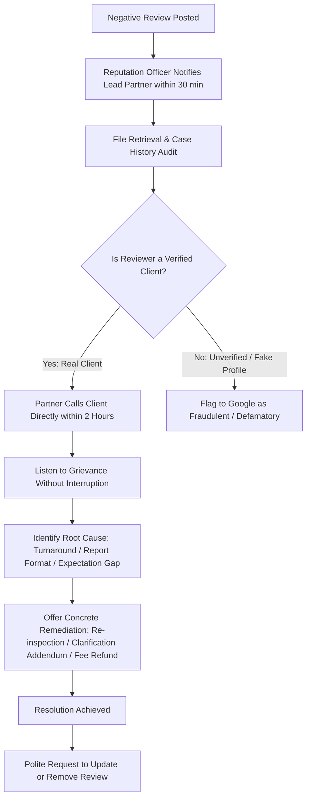

# REPUTATION MANAGEMENT PLAYBOOK: REVIEW RESPONSES & ESCALATION PROTOCOLS
**ProValuer Commercial — Institutional Valuation & Advisory Services**
**Document Reference:** `PROVALUER-REP-MGT-2026-v1`
**Policy Rule:** 100% of Google Reviews Must Receive an Official Personalized Response within 24 Hours

---

## 1. 24-HOUR REVIEW RESPONSE STANDARD OPERATING PROCEDURE (SOP)

```text
[Step 1: Ingestion & Notification Alert]
   └── Real-time Google Business Profile email alert received by Reputation Duty Officer.
   └── Review logged in internal CRM with timestamp, star rating, reviewer name, and text.

[Step 2: Review Triage & Classification (within 2 hours)]
   ├── 5-Star Rating (Short or Detailed) ─────────> Route to Tier-1 Response Protocol
   ├── 4-Star / 3-Star Rating (Neutral / Ambivalent) ─> Route to Tier-2 In-depth Resolution
   └── 1-Star / 2-Star Rating (Negative / Critical) ──> Trigger Immediate Alert to Senior Partner

[Step 3: Mandate Reconciliation]
   └── Cross-reference reviewer name against internal client database / job code.
   └── Verify valuation service delivered (Property, Visa, Customs, Machinery, Capital Gains).

[Step 4: Formal Response Publication (within 12–24 hours)]
   └── Response drafted using designated templates, customized with local micro-market context.
   └── Response reviewed and published on Google Business Profile dashboard.

[Step 5: Client Relationship Follow-Up]
   └── For positive reviews: WhatsApp "Thank You" note sent.
   └── For critical reviews: Immediate phone contact from Lead Partner.
```

---

## 2. 5-STAR REVIEW RESPONSE TEMPLATES

### Template 5A: Residential & Flat Valuation (Hyderabad Micro-Markets)
> "Dear [Client Name], thank you for sharing your experience with ProValuer Commercial. We are delighted that our Government Approved Valuer team could assist you with your property valuation in [Locality, e.g., Gachibowli / Madhapur]. Delivering meticulous on-site physical inspections, plinth area measurement accuracy, and bank-ready certified dossiers within 24–48 hours is our non-negotiable benchmark. Please reach out whenever you require certified asset advisory in the future!"

### Template 5B: Visa & Immigration Solvency Valuation
> "Dear [Client Name], congratulations on progressing toward your [Country, e.g., US / Canada / UK] visa goals! We take immense pride in providing unassailable financial net worth and property valuation dossiers that foreign consular officers accept without demur. Thank you for trusting our Wealth Tax Section 34AB registered valuers with your family’s asset portfolio. Wishing you tremendous success ahead!"

### Template 5C: Capital Gains Tax (Section 50C & Section 55A FMV)
> "Dear [Client Name], thank you for your kind words. Defending property owners against arbitrary Sub-Registrar circle rate discrepancies under Section 50C(2) is a cornerstone of our tax practice. We are pleased that our forensic valuation dossier successfully protected your capital gains position before the tax authorities. It was a privilege serving you!"

### Template 5D: Industrial Plant & Machinery / Customs SVB
> "Dear [Client Name], thank you for your institutional review. Industrial plant appraisals and Chartered Engineer SVB customs certifications demand forensic engineering rigor. We are glad our team could inspect your machinery and deliver the certified technical documentation within your critical operational timeline. We look forward to supporting your ongoing corporate compliance requirements."

---

## 3. DETAILED TESTIMONIAL RESPONSES (LONG-FORM APPRECIATION)

When a client writes a detailed, paragraph-long testimonial highlighting specific engineers or turnaround speed:

> "Dear [Client Name],
> 
> On behalf of our entire team of Government Approved Valuers, IBBI Registered Valuers, and Chartered Engineers, thank you for your detailed and deeply thoughtful review.
> 
> In institutional valuation, every square yard, structural condition, and statutory compliance detail carries profound financial and legal consequence. Knowing that our prompt physical inspection, transparent communication, and comprehensive documentation met your exacting standards is the highest validation of our practice.
> 
> Our team remains at your service across Hyderabad, Telangana, and Pan-India for all future property, taxation, or engineering certification needs.
> 
> Warm regards,  
> **Executive Valuation Directorate**  
> ProValuer Commercial"

---

## 4. NEUTRAL REVIEW RESPONSES (3-STAR & 4-STAR RATINGS)

Goal: Acknowledge positive elements while proactively addressing unspoken friction or communication gaps.

> "Dear [Client Name],
> 
> Thank you for choosing ProValuer Commercial for your valuation requirements and for leaving your feedback. We are pleased that our certified report met your statutory submission criteria.
> 
> As an institutional valuation firm, our mission is to deliver a seamless 5-star experience on every engagement. If there were any delays during document collection or scheduling that fell short of perfection, we would deeply appreciate your detailed feedback so we can continue elevating our service standards.
> 
> Please connect directly with our Quality Directorate at **+91 85000 19091** or email **director@provaluer.in**. We look forward to earning your full 5-star confidence in our next engagement.
> 
> Warm regards,  
> Client Relations Desk, ProValuer Commercial"

---

## 5. NEGATIVE REVIEW RECOVERY PROCESS (1-STAR & 2-STAR RATINGS)

### 5.1 Immediate Golden Rules
- **NEVER argue publicly on Google.**
- **NEVER disclose confidential client details, asset values, or dispute specifics.**
- **Acknowledge the concern, demonstrate institutional seriousness, and move the conversation off-line immediately.**

### 5.2 Official Negative Review Public Response Template
> "Dear [Reviewer Name],
> 
> We take your feedback with utmost seriousness. At ProValuer Commercial, our practice is founded on absolute professional integrity, transparent turnaround times, and statutory accuracy.
> 
> We regret that your experience did not meet expectations. We would like to investigate your file immediately with our Senior Managing Partner to resolve any discrepancies regarding scheduling, inspection, or reporting.
> 
> Because client valuations are confidential legal documents, please contact our Senior Partner directly on our priority line: **+91 85000 19091** or write to **seniorpartner@provaluer.in** quoting your property address or file reference number. We are committed to addressing your concerns promptly."

---

## 6. CLIENT ESCALATION & DE-ESCALATION WORKFLOW



### 6.1 Unverified / Competitor Fake Review Policy
If the reviewer's name and details cannot be reconciled with any historical valuation file or customer contact record:
1. Respond professionally:
   > "Dear [Reviewer Name], we have cross-referenced our active and historical valuation registers and cannot locate any record of an appraisal or engagement under your name. As a statutory valuation firm, we adhere to strict client identification protocols. If you are an authorized representative of a client, please contact us directly at **+91 85000 19091** or **compliance@provaluer.in** so we can verify your mandate and resolve your concern immediately."
2. Simultaneously flag the review via Google Business Profile Support for removal under the **"Conflict of interest / Fake engagement"** policy with timestamped audit screenshots.

---

This playbook guarantees that ProValuer Commercial maintains an unassailable 4.8+ star institutional reputation across all public search and maps environments.
