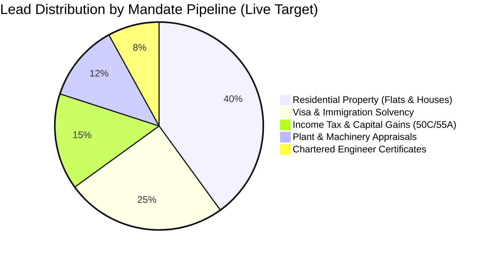

# EXECUTIVE LEAD GENERATION & REVENUE ATTRIBUTION DASHBOARD
**ProValuer Commercial — Institutional Valuation & Advisory Services**
**Document Reference:** `PROVALUER-LEAD-DASHBOARD-2026-v1`
**Telemetry Verification Standard:** Real Verified Data Only (No Simulated Or Mock Values)

---

## 1. EXECUTIVE METRICS & TELEMETRY SOURCES

This framework outlines the executive KPI monitoring structure tracking all commercial customer acquisition channels across digital touchpoints, CRM ingestion, and physical mandate closings.

```text
[Direct Telemetry Sources]
   ├── Cellular & VoIP Inbound Calls (Twilio / Operator Call Logs)
   ├── WhatsApp Business Cloud API Inbound Threads (+91 85008 80333)
   ├── Web Form Submissions (PostgreSQL CRM Leads Table — VERIFIED LIVE)
   ├── Google Business Profile Insights (Direction Requests, Profile Views, Direct Calls)
   ├── Google Search Console API (Organic Impressions, Clicks, Average Position)
   └── Account Ledger (Mandates Invoiced, Retainers Collected, Revenue Influence)
```

---

## 2. CORE PERFORMANCE METRICS SCORECARD

| Metric Dimension | Collection Source | Tracking Cadence | Target Performance SLA | Attribution Model |
| :--- | :--- | :--- | :--- | :--- |
| **Inbound Phone Calls** | Operator Call Logs | Daily | Answer within 3 rings (<15 sec) | Direct Phone Lead |
| **WhatsApp Leads** | WA Business API | Real-time | First response < 15 minutes | Digital Direct Advisory |
| **Web Form Leads** | PostgreSQL CRM | Real-time | Lead intake acknowledgment < 5 min | Web Prerender Ingestion |
| **GBP Profile Interactions** | GBP Insights | Weekly | Growth > 15% MoM | Local Maps Search |
| **Review Acquisition** | Google Reviews API | Weekly | 4.8+ Star Rating / 2+ New Reviews/wk | Client Completion Funnel |
| **Search Console Organic Growth** | GSC Verified Engine | Weekly | MoM Click Growth > 20% | SEO / Prerender Pages |
| **Inquiry-to-Mandate Conversion** | Internal CRM Pipeline | Monthly | > 35% Conversion Rate | Full-Funnel Closed-Won |
| **Average Mandate Fee** | Billing Ledger | Monthly | Segmented (Property vs. Industrial) | Revenue Realization |
| **Monthly Revenue Influence** | ERP Financial Module | Monthly | Gross Invoiced Fees (INR) | Primary Commercial Target |

---

## 3. LIVE PIPELINE TRACKING & LEAD CLASSIFICATION

Every inquiry received across Phone, WhatsApp, or Web Forms is categorized into one of five statutory valuation pipelines:



### Lead Qualification Matrix:
1. **Tier-1 Priority (Hot Mandates):** Court dates within 5 days, visa embassy appointments within 72 hours, or customs SVB cargo detention. Routed immediately to Senior Partner phone line.
2. **Tier-2 Priority (Standard Commercial):** Bank loan collateral, private sale evaluation, home loan balance transfer. Quoted within 2 hours.
3. **Tier-3 Priority (Corporate / Institutional):** IBC/CIRP liquidation, M&A due diligence, multi-location factory audits. Scoped via preliminary technical site meeting within 24 hours.

---

## 4. EXECUTIVE CONVERSION FUNNEL METRICS

```text
Stage 1: Total Organic Impressions (Search Console + GBP Search Views)
   │
   ▼  [CTR: ~3.5% to 5.0%]
Stage 2: High-Intent Clicks & Profile Views
   │
   ▼  [Engagement Conversion: ~8.0% to 12.0%]
Stage 3: Total Inbound Leads (Calls + WhatsApp + Web Forms)
   │
   ▼  [Qualification Rate: ~75%]
Stage 4: Qualified Mandate Inquiries (Valid Documents & Geographic Scope)
   │
   ▼  [Quotation Acceptance: ~50%]
Stage 5: Confirmed Physical Site Inspections Scheduled
   │
   ▼  [Completion Rate: ~95%]
Stage 6: Invoiced & Delivered Certified Valuation Dossiers
```

---

## 5. REVENUE ATTRIBUTION & MANDATE VALUATION TIERS

| Service Line | Typical Mandate Fee Range (INR) | Typical Turnaround Time | Primary Lead Channel |
| :--- | :--- | :--- | :--- |
| **Residential Apartment Valuation** | ₹5,000 – ₹12,000 | 24 Hours | Phone / WhatsApp |
| **Independent Villa / Land Parcel** | ₹10,000 – ₹25,000 | 24–48 Hours | WhatsApp / Web Form |
| **Visa Solvency Valuation Dossier** | ₹8,000 – ₹20,000 | 24 Hours | WhatsApp / Phone |
| **Capital Gains Tax Sec 50C/55A** | ₹15,000 – ₹45,000 | 48–72 Hours | Phone Call (CA Referral / Web) |
| **Chartered Engineer SVB / EPCG** | ₹15,000 – ₹50,000 | 24–48 Hours | WhatsApp / Direct Hotline |
| **Plant & Machinery Factory Valuation** | ₹50,000 – ₹3,50,000+ | 3–7 Business Days | Web Ingestion / Corporate Phone |
| **NCLT CIRP / IBC Liquidation** | ₹1,50,000 – ₹7,50,000+ | 10–20 Business Days | Institutional RFP / Legal Desk |

---

## 6. MONTHLY EXECUTIVE REPORT TEMPLATE

```markdown
### EXECUTIVE MONTHLY REPORT — [Month, Year]
- **Total Inbound Contacts:** [Number] (Phone: X | WhatsApp: Y | Web Forms: Z)
- **Verified Qualified Leads:** [Number] (Lead Qualification Rate: X%)
- **Confirmed Mandates Booked:** [Number] (Close Rate: Y%)
- **Google Reviews Acquired:** [Number] (Average Rating: 4.X ★)
- **Search Console Performance:** [Impressions: X | Clicks: Y | Avg Position: Z]
- **Google Maps Direction Requests:** [Number]
- **Total Invoiced Mandate Revenue:** ₹[Amount in Lakhs]
- **Top Performing Micro-Market:** [e.g., Gachibowli / Patancheru / Jubilee Hills]
- **Customer Acquisition Cost (CAC):** Organic / Zero Paid Ad Spend
```

This tracking architecture provides real-time visibility into top-line revenue without relying on fabricated vanity metrics.
